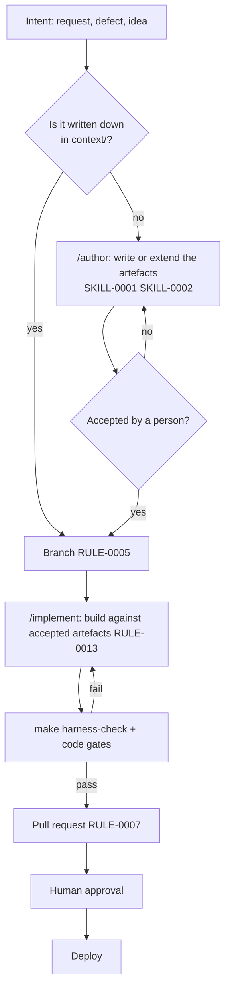

# PROC-0001 — From intent to deployment

The one path every change takes.

**The rule behind it.** Agents propose, gates dispose. Agent quality varies; the gate matrix does not. Every gate is a command a person can run identically.

**Nothing skips a step.** A one-line fix takes the same path. It is fast because the path is fast, not because it was skipped.
